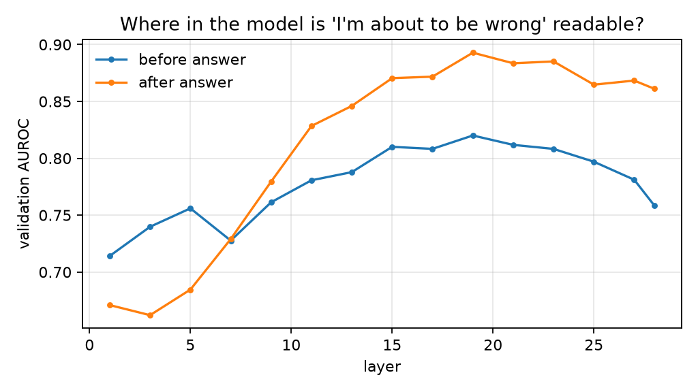

# Does It Know What It Knows?

Small probes read an open language model's hidden states and predict **"this answer will be wrong"**,
in one case before the model writes its first answer token. The question is whether that internal
signal is a cheaper and better warning than the usual alternatives: asking the model how sure it is,
or sampling it several times.

This is metacognition measured, not claimed: one of the indicator properties in
[Consciousness in Artificial Intelligence](https://arxiv.org/abs/2308.08708) (Butlin, Long et al., 2023),
tested as a working, benchmarked service.

## Results

**Qwen2.5-1.5B-Instruct, 3,000 closed-book questions, CPU laptop.** AUROC for spotting a wrong
answer, with 95% bootstrap intervals. "Test" uses held-out questions from TriviaQA and NQ-Open (the
datasets the probes were trained on); "transfer" is PopQA, a dataset the probes never saw.

| Method | AUROC test (n=447) | AUROC transfer (n=800) | Extra time per question |
|---|---|---|---|
| Probe, after answer (layer 19) | **0.872** [0.83, 0.91] | 0.829 [0.78, 0.87] | ~0 |
| Probe, before answer (layer 19) | 0.777 [0.72, 0.82] | 0.862 [0.83, 0.90] | ~0 (known before generating) |
| Token log-prob, min | 0.789 [0.74, 0.83] | **0.874** [0.84, 0.90] | 0 |
| Token log-prob, mean | 0.773 [0.72, 0.82] | 0.862 [0.82, 0.90] | 0 |
| Stated confidence | 0.763 [0.71, 0.81] | 0.735 [0.68, 0.79] | +1.1 s |
| Sampling agreement (k=3) | 0.744 [0.69, 0.79] | 0.840 [0.80, 0.88] | +2.6 s |

**Findings** (paired bootstrap on the same questions):

1. **On familiar question types, the after-answer probe beats every alternative**: +0.08 AUROC over
   the best token-probability score [+0.04, +0.13], +0.11 over stated confidence and +0.13 over
   sampling, at no extra cost.
2. **That advantage does not transfer.** On PopQA it falls behind the free token-probability score
   (−0.045 [−0.085, −0.005]): the probe partly learns cues specific to its training datasets.
3. **The before-answer probe transfers better than the after-answer one** (+0.034 [+0.001, +0.067]
   on PopQA) and ties the token-probability score on both splits, while being available before a
   single answer token exists, early enough to skip generation or fetch sources instead.
4. **Asking the model how sure it is is the weakest signal**, and sampling costs 2.6 s per question
   without beating free token probabilities.

Labels: automatic correctness scoring agreed with hand labels on 77 of 78 pilot answers (kappa 0.93);
the one miss led to a stricter rule for hedged and list answers. Error rates: 75% test, 87% transfer
(small models answer most closed-book trivia wrongly, which is the behaviour being studied).



The signal rises through the middle of the network and peaks at layer 19 of 28. The pilot on
Qwen2.5-0.5B showed the same shape with wider intervals (only ~30 correct answers per split).

## How it works

```
questions (TriviaQA, NQ-Open; PopQA held out)
   │
   ▼
kwik collect ── open model answers each question (greedy)
   │              saves: answer, correct/incorrect, token log-probs,
   │              hidden states at two positions × every 2nd layer
   │                "pre": last prompt token (before any answer token)
   │                "end": when the model reads its own last answer token
   ▼
kwik baselines ─ stated confidence (extra call) + sampling agreement (k extra samples)
   ▼
kwik train ───── logistic-regression probe per layer × position; layer, position and
   │              regularisation chosen on validation only; test and transfer used once
   ▼
kwik report ──── results.md, layer curve, risk-coverage plot
   ▼
kwik serve ───── FastAPI: POST /answer → answer + risk score (from "pre") + timings
kwik bench ───── added latency of the probe vs plain generation
```

**Design decisions**

- **Label:** wrong = neither exact match nor whole-word containment of any gold alias (predictions over
  10 words get no containment credit). Checked against 200 hand labels with `kwik handcheck-*`
  before any number is quoted.
- **Splits:** TriviaQA + NQ-Open pooled and split 60/20/20, stratified by dataset. PopQA (long-tail
  entities) is never seen in training, which tests whether the probe transfers.
- **Fair calibration:** every baseline gets a Platt mapping fitted on validation, so ECE compares
  probabilities with probabilities. AUROC is unaffected by that mapping.
- **Honest naming:** "sampling agreement" is a cheap stand-in for semantic entropy (it matches answers by
  normalized text rather than clustering them by meaning).
- **Resumable:** `collect` writes one shard per batch and skips finished questions when re-run.

## Run it

### 1. Pilot on your laptop (CPU, about 30–90 min; time it)

Anaconda Prompt:

```
conda create -n kwik python=3.11 -y
conda activate kwik
git clone https://github.com/feliciachen01/kwik.git
cd kwik
pip install -e ".[serve,dev]"
pytest -q
kwik all --config configs/pilot.yaml
```

Then open `runs/pilot-qwen0.5b/results.md`. Run long jobs overnight, never during the Truthful
Companion's latency tests.

### 2. Check the labels by hand

```
kwik handcheck-export --config configs/pilot.yaml
```

Fill the `human_correct` column of `runs/pilot-qwen0.5b/handcheck.csv` with 1 or 0, then:

```
kwik handcheck-agree --config configs/pilot.yaml
```

### 3. Bigger runs

- `configs/laptop-1.5b.yaml`: Qwen2.5-1.5B on CPU, 3,000 questions (about 2 h 45 min on a Core Ultra laptop). Full report: `docs/qwen1.5b_results.md`.
- `notebooks/colab_7b.ipynb`: Qwen2.5-7B in 4-bit on a free Colab T4. Use it before Dec 1.

### 4. Serve and benchmark

```
kwik bench --config configs/pilot.yaml
kwik serve --config configs/pilot.yaml
```

```
curl -X POST localhost:8000/answer -H "Content-Type: application/json" -d "{\"question\": \"Who wrote Hamlet?\"}"
```

## Data and models

| Source | Hub ID | Use | License |
|---|---|---|---|
| TriviaQA | `mandarjoshi/trivia_qa` (rc.nocontext, validation) | train / val / test | see dataset card |
| NQ-Open | `google-research-datasets/nq_open` (validation) | train / val / test | CC BY-SA 3.0 |
| PopQA | `akariasai/PopQA` (test) | transfer only | see dataset card |
| Qwen2.5 Instruct 0.5B / 1.5B / 7B | `Qwen/Qwen2.5-*-Instruct` | models | Apache 2.0 |

## Prior work

- Kossen et al., [Semantic Entropy Probes](https://arxiv.org/abs/2406.15927) (2024): probes on hidden
  states approximate semantic entropy cheaply. This repo adds a "before the answer" position,
  transfer to a held-out long-tail dataset, and a served API with measured overhead.

## Tests

`pytest -q` runs scoring and metric unit tests plus an offline end-to-end run on a tiny randomly
initialised model. That run checks the plumbing only; its numbers mean nothing.
