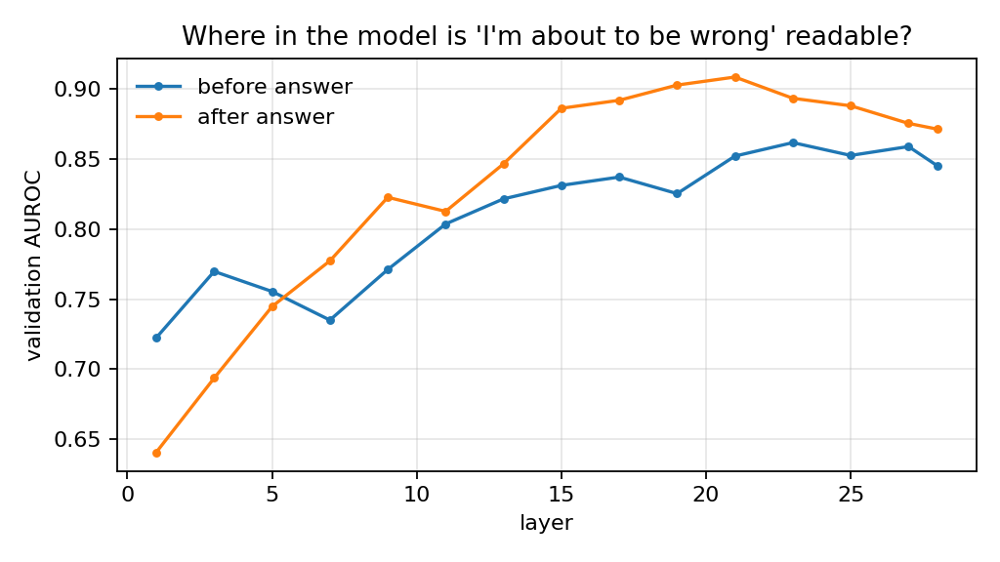

# Results: qwen7b

Model: `Qwen/Qwen2.5-7B-Instruct`. Questions: {'train': 1320, 'val': 445, 'test': 447, 'transfer': 800}. Error rate by split: {'train': 0.636, 'val': 0.598, 'test': 0.6, 'transfer': 0.855}.

Higher AUROC is better (spotting wrong answers). Lower ECE, Brier and AURC are better.
acc@80% = accuracy if the system answers only the 80% of questions it is least worried about.

## Test split (same datasets as training)

| method | n | auroc [95% CI] | ece | brier | aurc | acc@80% |
|---|---|---|---|---|---|---|
| probe (after answer, layer 21) | 447 | 0.863 [0.83, 0.90] | 0.102 | 0.154 | 0.315 | 0.483 |
| logprob (min) | 447 | 0.813 [0.77, 0.85] | 0.064 | 0.177 | 0.373 | 0.480 |
| logprob (mean) | 447 | 0.806 [0.77, 0.85] | 0.066 | 0.182 | 0.379 | 0.486 |
| sampling agreement | 447 | 0.799 [0.76, 0.84] | 0.043 | 0.172 | 0.349 | 0.480 |
| probe (before answer, layer 23) | 447 | 0.783 [0.74, 0.83] | 0.126 | 0.203 | 0.380 | 0.478 |
| stated confidence | 447 | 0.708 [0.67, 0.75] | 0.052 | 0.208 | 0.400 | 0.472 |

## Transfer split (dataset never seen in training)

| method | n | auroc [95% CI] | ece | brier | aurc | acc@80% |
|---|---|---|---|---|---|---|
| logprob (mean) | 800 | 0.895 [0.87, 0.92] | 0.100 | 0.102 | 0.655 | 0.181 |
| logprob (min) | 800 | 0.895 [0.86, 0.92] | 0.096 | 0.099 | 0.656 | 0.181 |
| probe (after answer, layer 21) | 800 | 0.858 [0.82, 0.90] | 0.071 | 0.096 | 0.665 | 0.175 |
| probe (before answer, layer 23) | 800 | 0.844 [0.80, 0.89] | 0.055 | 0.088 | 0.666 | 0.172 |
| sampling agreement | 800 | 0.839 [0.80, 0.87] | 0.122 | 0.113 | 0.698 | 0.177 |
| stated confidence | 800 | 0.725 [0.68, 0.76] | 0.188 | 0.154 | 0.765 | 0.172 |

Correct answers available for evaluation: test 179, transfer 116. Fewer than ~100 makes the intervals wide.

## Is the before-answer probe better? (paired bootstrap, same questions)

| split | versus | AUROC difference [95% CI] | verdict |
|---|---|---|---|
| test | probe (after answer, layer 21) | -0.080 [-0.120, -0.041] | probe worse |
| test | logprob (mean) | -0.024 [-0.076, +0.027] | no clear difference |
| test | logprob (min) | -0.030 [-0.084, +0.019] | no clear difference |
| test | stated confidence | +0.075 [+0.017, +0.127] | probe better |
| test | sampling agreement | -0.016 [-0.068, +0.037] | no clear difference |
| transfer | probe (after answer, layer 21) | -0.014 [-0.048, +0.016] | no clear difference |
| transfer | logprob (mean) | -0.051 [-0.090, -0.010] | probe worse |
| transfer | logprob (min) | -0.050 [-0.089, -0.010] | probe worse |
| transfer | stated confidence | +0.119 [+0.064, +0.173] | probe better |
| transfer | sampling agreement | +0.006 [-0.039, +0.052] | no clear difference |

## Cost

- Answer generation: 0.624 s per question (batched, includes saving hidden states)
- Stated confidence: +0.568 s per question (extra call)
- Sampling agreement: +1.328 s per question (extra samples)

## Chosen probes (picked on validation only)

- pre: layer 23, C=0.01, val AUROC 0.862
- end: layer 21, C=0.01, val AUROC 0.909

Stated-confidence replies that contained a usable number: 1.0

Automatic correctness labels must be checked against hand labels (`kwik handcheck-agree`) before these numbers are quoted.
